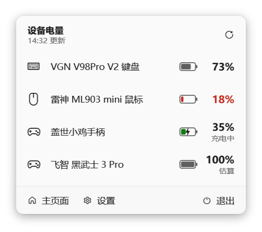
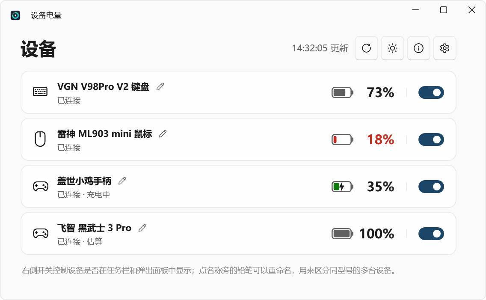

# 设备电量

在 Windows 任务栏上直接显示无线键盘、鼠标、手柄的电量 
不用安装、也不用打开各家的驱动软件

[下载](#下载安装) · [支持的设备](#支持的设备) · [使用说明](#使用说明) · [常见问题](#常见问题)

 

## 功能

- 🔋 **任务栏电量条**：每台在线设备显示「图标 + 电池 + 百分比」；电量偏低变黄、过低变红，充电时变绿并显示闪电。
- 🪟 **弹出面板**：点一下电量条，就能看到所有设备的电量和充电状态。
- 🔔 **低电量提醒**：电量低于设定值时弹出系统通知，同一次低电量只提醒一次。
- 🎛️ **同型号多台**：插了好几个同型号的接收器也能分别显示；可以给每台设备改名，也可以隐藏不想看的设备。
- 🌗 **深浅色**：跟随系统，也可以在主页面一键切换。
- ⬆️ **自动更新**：在后台检查并下载新版本，替换后自动重启。

<picture>
  <source media="(prefers-color-scheme: dark)" srcset="docs/images/flyout-dark.png">
  
</picture>
<picture>
  <source media="(prefers-color-scheme: dark)" srcset="docs/images/main-dark.png">
  
</picture>

## 支持的设备

| 品牌 | 设备 | 说明 |
|---|---|---|
| **VGN** | V98Pro V2 键盘 | 2.4G 接收器 |
| **雷神** | ML903 mini 鼠标 | 星闪接收器、有线 |
| **盖世小鸡** | 2.4G 接收器手柄 | |
| **飞智** | 黑武士 3 Pro 手柄 | 电量为估算值；需要安装飞智空间站，并以管理员权限运行 |

使用同款接收器的其他型号大概率也能用（未实测），例如：
- VGN / VXE / ATK 的 2.4G 键盘（VGN S99、VXE75、N75 PRO、VXE V87、KAFKA 系列等）
- 盖世小鸡 T3 Pro、T4N Pro 等手柄

## 下载安装

到 [Releases](https://github.com/AnLifeX/DeviceBatteryTray/releases/latest) 下载：

| 版本 | 文件 | 说明 |
|---|---|---|
| **安装版**（推荐） | `DeviceBatteryTray-win-Setup.exe` | 双击安装，不需要管理员权限；缺少 .NET 8 运行时会自动安装；创建桌面和开始菜单快捷方式 |
| 便携版 | `DeviceBatteryTray-win-Portable.zip` | 解压到任意目录后运行 `设备电量.exe`；需要先安装 [.NET 8 桌面运行时](https://dotnet.microsoft.com/download/dotnet/8.0) |

两种版本都会自动更新。安装版可以在「设置 → 应用」里卸载，卸载时会还原任务栏，并删除程序的设置和日志。

### 系统要求

- Windows 10，任务栏横向放置（在屏幕底部或顶部）
- 任务栏竖着放时，会改为在托盘区显示程序图标，点它同样能打开弹出面板
- Windows 11 尚未测试

## 使用说明

**任务栏电量条**
- 显示在托盘区左侧，只显示已连接、没有休眠的设备；设备多时分两行，最多显示 8 台，其余的在弹出面板里看。
- 左键或右键点击电量条，打开弹出面板。

**弹出面板**
- 显示所有在线设备的电量、充电状态和更新时间，右上角可以立即刷新。
- 底部可以打开主页面、设置，或退出程序。点面板外面或按 Esc 关闭。

**主页面**（双击桌面图标打开；关闭主页面后，程序会继续在后台运行）
- 列出所有已插入接收器的设备及其状态（在线、休眠、需要管理员权限）。
- 点名称旁的铅笔可以改名（留空恢复默认）；右侧开关控制这台设备是否显示在任务栏和弹出面板里，隐藏的设备也不会提醒。
- 有新版本时，页面顶部会显示提示，可以立即更新。

**设置**

| 选项 | 默认 | 说明 |
|---|---|---|
| 开机自启 | 关 | 登录 Windows 后在后台启动 |
| 刷新间隔 | 30 秒 | 多久读取一次电量，可设 5 ~ 3600 秒 |
| 低电量提醒 | 低于 20% | 可选 10% ~ 30% 或关闭；充电中、已隐藏的设备不提醒 |
| 读取飞智黑武士 | 开 | 需要管理员权限，见下方说明 |
| 自动更新 | 开 | 检查间隔可选 1 小时 ~ 每周，默认 6 小时 |

### 飞智黑武士与管理员权限

读取飞智黑武士 3 Pro 的电量需要管理员权限。程序只在**同时满足**以下条件时才会请求：
设置里开着「读取飞智黑武士」、装了飞智空间站、插着黑武士的接收器。其他情况下都以普通权限运行，不会弹出 UAC。

- 拒绝 UAC 也能正常使用，只是读不到黑武士；之后可以在主页面黑武士那一行点「以管理员身份重启」。
- 打开「开机自启」后，开机和手动启动都不会再弹 UAC。
- 不用黑武士的话，在设置里关掉「读取飞智黑武士」，程序就永远不会请求管理员权限。

## 常见问题

<b>任务栏上没有显示某台设备？</b>

电量条只显示已连接、没有休眠的设备。设备休眠时会自动隐藏，唤醒后（动一下鼠标、按一下键盘）下次刷新就会出现。
也可以打开主页面看看它的状态，以及是否被右侧的开关隐藏了。

<b>安装时提示「Windows 已保护你的电脑」？</b>

程序没有代码签名证书，第一次运行时 SmartScreen 可能会拦截。点「更多信息」→「仍要运行」即可。

<b>程序被强制结束后，任务栏上的按钮区变窄了？</b>

程序正常退出时会自动还原任务栏，被强制结束时则来不及。重新打开程序再正常退出即可恢复；
也可以在命令行运行一次 `"%LOCALAPPDATA%\DeviceBatteryTray\current\DeviceBatteryTray.exe" --restore-taskbar`。

<b>飞智黑武士的电量为什么是「估算」？</b>

手柄只上报大致的电量档位，不是精确的百分比，所以显示的是按档位换算的估算值。

<b>设置和日志存在哪里？</b>

在 `%APPDATA%\DeviceBatteryTray\` 下：`settings.json` 是设置，`DeviceBatteryTray.log` 是日志。反馈问题时附上日志，方便排查。

<b>命令行参数</b>

程序位置：安装版是 `%LOCALAPPDATA%\DeviceBatteryTray\current\DeviceBatteryTray.exe`，便携版是解压目录里 `current\DeviceBatteryTray.exe`。

| 参数 | 说明 |
|---|---|
| `--background` | 只在任务栏后台运行，不打开主页面（开机自启用的就是它） |
| `--exit` | 让正在运行的程序正常退出 |
| `--restore-taskbar` | 还原被缩窄的任务栏按钮区 |
| `--no-elevate` | 不请求管理员权限 |
| `--dump out.txt` | 读一遍所有设备，把原始收发记录写到 `out.txt`，反馈设备问题时使用 |

## 原理

各设备的电量协议来自对官方驱动软件的分析，并在实机上验证过。程序直接通过 USB HID 与接收器通讯，不依赖厂商软件（飞智黑武士除外）。
协议细节见 [docs/protocols](docs/protocols/README.md)，编译和发布见[开发说明](docs/development.md)。

## 声明

本项目与上述设备厂商无关。协议通过分析本机已安装的官方软件得到，仅用于读取自己设备的电量。
